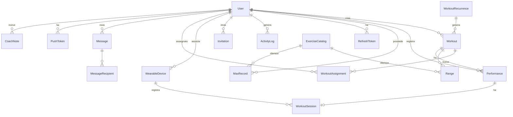

# 02 – Modello dati

Schema **target** per il nuovo backend a servizio dell'app Flutter. Lo schema legacy Flask
(SQLAlchemy) è riportato in fondo, nella sezione *Differenze rispetto allo schema legacy*,
solo come riferimento per la migrazione dei dati.

Convenzioni:
- Chiavi primarie `id` intere autoincrementali. Gli identificativi esposti alle API sono gli stessi.
- Tutti i timestamp sono in **UTC** con timezone (`timestamptz`). Le date di calendario
  (giorno dell'allenamento, data del test) sono `date` pure, senza ora.
- Ogni entità ha `created_at` e `updated_at` gestiti dal server.
- Le eliminazioni sono **fisiche** salvo dove indicato (soft delete tramite `is_active`).

## Entità

### User
| Campo | Tipo | Note |
|-------|------|------|
| id | int PK | |
| username | str(50) | **unique**, obbligatorio, case-insensitive |
| email | str(200) | **unique**, obbligatorio, validata come email |
| password_hash | str(255) | Argon2id o bcrypt. Mai esposto |
| first_name | str(100) | obbligatorio |
| last_name | str(100) | obbligatorio |
| role | enum `athlete` \| `coach` \| `superuser` | default `athlete` |
| is_enabled | bool | default `false`. Vedi RF-01-02 |
| birth_date | date | nullable; usata per la stima della FC massima |
| max_heart_rate | int | nullable; se assente stimata da `birth_date` (vedi [12-monitoraggio-cardio.md](12-monitoraggio-cardio.md)) |
| last_activity_at | timestamptz | nullable; aggiornato a ogni richiesta autenticata |
| created_at | timestamptz | |
| updated_at | timestamptz | |

Relazioni: `workouts` (creati), `performances`, `max_records`, `refresh_tokens`, `invitations` (inviati).

### Workout
| Campo | Tipo | Note |
|-------|------|------|
| id | int PK | |
| date | date | giorno di programmazione, obbligatorio |
| display_order | int | posizione nel giorno, normalizzata 1..N per data |
| name | str(200) | titolo (es. "Work 1", "Every 1:30 x 6 sets") |
| description | text | contenuto dell'allenamento (righe degli esercizi) |
| category | enum `strength` \| `metcon` \| `skill` \| `monostructural` \| `mobility` \| `benchmark` \| `test` \| `other` | nullable nel legacy migrato |
| result_type | enum `time` \| `rounds_reps` \| `load` \| `reps` \| `distance` \| `calories` \| `none` | tipo di score atteso (vedi [13-analisi-dati.md](13-analisi-dati.md)) |
| is_benchmark | bool | default `false`; benchmark ripetibile con nome canonico |
| time_cap_seconds | int | nullable; time cap per `result_type = time` (RF-06-01) |
| status | enum `draft` \| `published` | default `draft`; gli atleti vedono solo `published` |
| published_at | timestamptz | nullable |
| audience | enum `all` \| `assigned` \| `personal` | default `all` (RF-04-D11..D12) |
| owner_id | FK User (ON DELETE CASCADE) | valorizzato solo per `personal`: l'atleta proprietario |
| recurrence_id | FK WorkoutRecurrence (ON DELETE SET NULL) | nullable; regola che ha generato l'occorrenza |
| created_by | FK User (ON DELETE SET NULL) | coach o superuser che lo ha inserito, nullable |
| created_at | timestamptz | |
| updated_at | timestamptz | |

Relazioni: `ranges`, `performances`, `assignments` (WorkoutAssignment).

> La direzione scelta in [04-workout.md](04-workout.md) (RF-04-D1..D3) è l'editor strutturato:
> `description` resta come rappresentazione testuale generata, e il contenuto vive in
> `WorkoutLine` (sotto). L'entità `Range` è assorbita da `WorkoutLine`.

### WorkoutLine
| Campo | Tipo | Note |
|-------|------|------|
| id | int PK | |
| workout_id | FK Workout (ON DELETE CASCADE) | |
| position | int | ordine nel workout |
| kind | enum `exercise` \| `text` \| `block` | |
| parent_id | FK WorkoutLine (ON DELETE CASCADE) | nullable; riga di blocco che contiene questa riga (un solo livello, RF-04-D2b) |
| exercise_id | FK ExerciseCatalog | obbligatorio se `kind = exercise` |
| text | text | testo libero (`kind = text`) |
| sets_min | int | `kind = block`: giri minimi |
| sets_max | int | `kind = block`: giri massimi (= min se fisso) |
| qty | numeric(8,2) | nullable; quantità |
| qty_unit | enum `reps` \| `m` \| `cal` \| `sec` \| `min` | |
| load_kind | enum `none` \| `kg` \| `pct` \| `offset_sec` \| `hr_zone` | intensità (RF-04-D2) |
| load_value | numeric(8,2) | kg, percentuale, secondi o numero di zona 1–5 |
| ref_test_type | enum come MaxRecord.test_type | nullable; test di riferimento per `pct` e `offset_sec` (default `1rm`) |
| ref_test_distance_m | int | nullable; distanza del test di riferimento (RF-05-D2b) |
| cadence | str(20) | nullable; ritmo, es. "20-22" s/m |
| note | str(200) | nullable |

### Range (carico percentuale o scarto di un workout)
| Campo | Tipo | Note |
|-------|------|------|
| id | int PK | |
| workout_id | FK Workout (ON DELETE CASCADE) | |
| exercise_id | FK ExerciseCatalog | **FK reale**, non più match per nome |
| kind | enum `pct` \| `offset` | `pct`: percentuale del massimale. `offset`: secondi da sommare al pace |
| value | int | es. 70 (pct) oppure 10 (offset, secondi) |
| position | int | ordine di visualizzazione dentro il gruppo |

Un workout può avere fino a **3 gruppi** di range (un gruppo per esercizio), ciascuno con N valori.
Il gruppo è identificato da `exercise_id`; l'ordine dei gruppi segue il primo `position` di ciascuno.

### Performance (score)
| Campo | Tipo | Note |
|-------|------|------|
| id | int PK | |
| workout_id | FK Workout (ON DELETE CASCADE) | |
| user_id | FK User (ON DELETE CASCADE) | atleta |
| date | date | giorno di esecuzione, default = data del workout |
| result | str(200) | rappresentazione testuale dello score (sempre valorizzata, anche per i legacy) |
| result_seconds | int | nullable; per `result_type = time` |
| result_rounds | int | nullable; per `rounds_reps` |
| result_reps | int | nullable; per `rounds_reps` e `reps` |
| result_load | numeric(8,2) | nullable; per `load` |
| result_distance | int | nullable; metri |
| result_calories | int | nullable |
| is_rx | bool | default `true`; `false` = scalato |
| is_capped | bool | default `false`; tempo scaduto al cap, `result_reps` = ripetizioni completate (RF-06-01) |
| is_completed | bool | default `true`; per `result_type = none` è l'unico dato dello score |
| max_record_id | FK MaxRecord (ON DELETE SET NULL) | nullable; massimale creato da uno score di tipo test (RF-06-02) |
| entered_by | FK User (ON DELETE SET NULL) | nullable; valorizzato se inserito dal coach per conto dell'atleta |
| notes | text | nullable |
| created_at | timestamptz | |
| updated_at | timestamptz | |

Vincolo: **unique (workout_id, user_id)**. Un atleta ha al massimo uno score per workout;
per correggerlo lo modifica.

### MaxRecord (massimale / test)
| Campo | Tipo | Note |
|-------|------|------|
| id | int PK | |
| user_id | FK User (ON DELETE CASCADE) | |
| exercise_id | FK ExerciseCatalog | **FK reale** |
| date | date | data del test |
| test_type | enum `1rm` \| `3rm` \| `5rm` \| `max_reps` \| `time` \| `pace` \| `distance` \| `calories` \| `hold` | vedi RF-05-D2 |
| value | numeric(8,2) | valore nell'unità indicata: kg, reps, minuti decimali (8.5 = 8'30"), metri, calorie, secondi |
| unit | enum come ExerciseCatalog.unit | unità al momento dell'inserimento (RF-05-D3) |
| test_duration_seconds | int | nullable; durata del test per `max_reps`, `distance`, `calories` |
| test_distance_m | int | nullable; distanza del test per `time` e `pace` (500, 1000, 2000, 5000). Unique (user_id, exercise_id, test_type, test_distance_m, date) |
| workout_id | FK Workout (ON DELETE SET NULL) | nullable; sessione di test da cui proviene |
| entered_by | FK User (ON DELETE SET NULL) | nullable; se inserito dal coach |
| notes | text | nullable |
| created_at | timestamptz | |
| updated_at | timestamptz | |

Il massimale corrente di un atleta per un esercizio è il record con `date` più recente
(a parità di data, l'`id` maggiore). Lo storico è l'intera lista ordinata per data.

### ExerciseCatalog
| Campo | Tipo | Note |
|-------|------|------|
| id | int PK | |
| name | str(200) | **unique** case-insensitive |
| category | enum `weightlifting` \| `monostructural` \| `bodyweight` \| `skill` | obbligatoria (RF-05-D1) |
| aliases | text[] | grafie alternative per ricerca e import da testo (RF-05-D9) |
| allowed_test_types | text[] | tipi di test ammessi (RF-05-D2) |
| unit | enum `kg` \| `reps` \| `min` \| `pace` \| `distance` \| `cal` | default `kg` |
| ref_distance | int | metri di riferimento del pace (500 remo/ski, 1000 corsa). Obbligatorio se `unit = pace`, altrimenti null |
| pct_mode | enum `literal` \| `intensity` | `literal`: valore × %. `intensity`: valore × 100 / % (tempi e pace). Default `literal` |
| is_active | bool | default `true`. Soft delete: gli inattivi non sono selezionabili ma restano validi per record e calcoli esistenti |
| created_at | timestamptz | |
| updated_at | timestamptz | |

### WorkoutAssignment
| Campo | Tipo | Note |
|-------|------|------|
| id | int PK | |
| workout_id | FK Workout (ON DELETE CASCADE) | workout con `audience = assigned` |
| user_id | FK User (ON DELETE CASCADE) | atleta assegnato |
| created_at | timestamptz | |

Unique (workout_id, user_id).

### WorkoutRecurrence
| Campo | Tipo | Note |
|-------|------|------|
| id | int PK | |
| template_workout_id | FK Workout (ON DELETE CASCADE) | workout modello da cui generare le occorrenze |
| weekdays | int[] | giorni della settimana (1 = lunedì … 7 = domenica) |
| start_date | date | |
| end_date | date | nullable = senza fine |
| is_active | bool | default `true` |
| created_by | FK User (ON DELETE SET NULL) | |
| created_at | timestamptz | |
| updated_at | timestamptz | |

Le occorrenze sono righe `Workout` generate in anticipo (orizzonte 8 settimane, esteso da un
job giornaliero) con `recurrence_id` valorizzato. Modificare la regola rigenera solo le
occorrenze future senza score (RF-04-D13).

### Message (broadcast)
| Campo | Tipo | Note |
|-------|------|------|
| id | int PK | |
| sender_id | FK User (ON DELETE SET NULL) | coach o superuser |
| title | str(80) | |
| body | text | max 2000 |
| attachment_url | str(500) | nullable |
| is_pinned | bool | default `false` (RF-08-D7) |
| expires_at | timestamptz | nullable |
| withdrawn_at | timestamptz | nullable |
| created_at | timestamptz | |
| updated_at | timestamptz | |

### MessageRecipient
| Campo | Tipo | Note |
|-------|------|------|
| id | int PK | |
| message_id | FK Message (ON DELETE CASCADE) | |
| user_id | FK User (ON DELETE CASCADE) | |
| read_at | timestamptz | nullable |

Unique (message_id, user_id).

### PushToken
| Campo | Tipo | Note |
|-------|------|------|
| id | int PK | |
| user_id | FK User (ON DELETE CASCADE) | |
| token | str(500) | token FCM, unique |
| platform | enum `android` \| `ios` \| `web` | |
| last_seen_at | timestamptz | |
| created_at | timestamptz | |

### NotificationPreference
| Campo | Tipo | Note |
|-------|------|------|
| id | int PK | |
| user_id | FK User (ON DELETE CASCADE) | |
| event | str(50) | codice evento (RF-08-D8) |
| push | bool | default `true` |
| email | bool | default per evento |

Unique (user_id, event).

### BoxSettings
| Campo | Tipo | Note |
|-------|------|------|
| id | int PK | singola riga |
| name | str(100) | nome del box |
| logo_url | str(500) | |
| contact_channel | jsonb | tipo e valore per "Contatta il coach" (RF-08-D6) |
| phrases_enabled | bool | default `true` |
| inactivity_days | int | default 14 (RF-13-15) |
| updated_at | timestamptz | |

### Phrase
| Campo | Tipo | Note |
|-------|------|------|
| id | int PK | |
| kind | enum `motivational` \| `rest_day` \| `timer_end` \| `pr` | |
| text | str(200) | |
| is_active | bool | default `true` |
| is_original | bool | `true` per le frasi migrate dal legacy (ripristinabili, RF-10-D11) |
| created_at | timestamptz | |

### WearableDevice
| Campo | Tipo | Note |
|-------|------|------|
| id | int PK | |
| user_id | FK User (ON DELETE CASCADE) | |
| kind | enum `ble_hr` \| `healthkit` \| `health_connect` \| `polar_flow` | |
| name | str(200) | nome mostrato (es. "Polar H10 A1B2C3") |
| identifier | str(200) | id BLE o identificativo della sorgente |
| last_seen_at | timestamptz | nullable |
| created_at | timestamptz | |

### WorkoutSession (sessione cardio)
| Campo | Tipo | Note |
|-------|------|------|
| id | int PK | |
| performance_id | FK Performance (ON DELETE CASCADE) | unique: una sessione per score |
| device_id | FK WearableDevice (ON DELETE SET NULL) | nullable |
| source | enum `ble_hr` \| `healthkit` \| `health_connect` \| `polar_flow` | |
| started_at | timestamptz | |
| ended_at | timestamptz | |
| avg_hr | int | |
| max_hr | int | |
| min_hr | int | |
| zone_seconds | jsonb | secondi per zona `{"z1": …, "z5": …}` |
| samples | bytea | serie FC compressa (timestamp relativo in ms, bpm) |
| created_at | timestamptz | |

### HeartRateZoneSettings
| Campo | Tipo | Note |
|-------|------|------|
| id | int PK | |
| user_id | FK User (ON DELETE CASCADE) | nullable: null = default del box |
| z1_min … z5_min | int | percentuali della FC massima (RF-12-13) |
| updated_at | timestamptz | |

### CoachNote
| Campo | Tipo | Note |
|-------|------|------|
| id | int PK | |
| athlete_id | FK User (ON DELETE CASCADE) | |
| author_id | FK User (ON DELETE SET NULL) | coach o superuser |
| body | text | non visibile all'atleta (RF-13-12) |
| created_at | timestamptz | |
| updated_at | timestamptz | |

### Invitation
| Campo | Tipo | Note |
|-------|------|------|
| id | int PK | |
| email | str(200) | destinatario, case-insensitive |
| role | enum `athlete` \| `coach` | ruolo assegnato all'accettazione. `coach` solo se l'invito è emesso da un superuser |
| token_hash | str(255) | hash del token monouso contenuto nel link |
| invited_by | FK User (ON DELETE SET NULL) | coach o superuser che ha inviato l'invito |
| expires_at | timestamptz | default 7 giorni dall'invio |
| accepted_at | timestamptz | nullable; valorizzato all'accettazione |
| accepted_user_id | FK User (ON DELETE SET NULL) | nullable; account creato dall'invito |
| revoked_at | timestamptz | nullable |
| created_at | timestamptz | |

Un invito è **pendente** se non accettato, non revocato e non scaduto. Per una stessa email
può esistere al massimo un invito pendente (indice unique parziale su `email`).

### RefreshToken
| Campo | Tipo | Note |
|-------|------|------|
| id | int PK | |
| user_id | FK User (ON DELETE CASCADE) | |
| token_hash | str(255) | hash del refresh token |
| device_name | str(200) | nullable, descrizione del dispositivo |
| expires_at | timestamptz | |
| revoked_at | timestamptz | nullable |
| created_at | timestamptz | |

Necessaria per l'autenticazione mobile con token (vedi [03-autenticazione-e-profilo.md](03-autenticazione-e-profilo.md)).

### ActivityLog
| Campo | Tipo | Note |
|-------|------|------|
| id | int PK | |
| user_id | FK User (ON DELETE SET NULL) | nullable per eventi anonimi (login fallito) |
| username | str(50) | snapshot dello username al momento dell'evento |
| role | enum come User.role | snapshot del ruolo al momento dell'evento |
| action | str(50) | codice evento (elenco in RF-08-D13) |
| target_type | str(50) | nullable; tipo di oggetto (workout, performance, user…) |
| target_id | int | nullable |
| on_behalf_of | FK User (ON DELETE SET NULL) | nullable; atleta per cui il coach ha agito |
| details | jsonb | nullable; valori prima/dopo, payload |
| ip_address | inet | nullable |
| user_agent | str(300) | nullable |
| created_at | timestamptz | |

## Diagramma

## Regole di integrità

- RF-02-01 – Username ed email sono univoci, con confronto case-insensitive, verificati in registrazione, modifica profilo e gestione account.
- RF-02-02 – Eliminando un utente si eliminano performance, massimali e refresh token. I workout da lui creati **restano** e `created_by` viene impostato a null: la programmazione è patrimonio del box, non del singolo coach.
- RF-02-03 – Eliminando un workout si eliminano i suoi range e le performance collegate.
- RF-02-04 – Un atleta può avere al massimo una performance per workout (unique `workout_id, user_id`).
- RF-02-05 – Range e MaxRecord referenziano il catalogo esercizi tramite FK. Non è ammesso un range o un massimale su un esercizio non a catalogo.
- RF-02-06 – Rinominare un esercizio a catalogo non richiede alcun riallineamento: i riferimenti sono per id.
- RF-02-07 – Un esercizio referenziato da range o massimali non può essere eliminato fisicamente: viene disattivato (`is_active = false`). Un esercizio mai referenziato può essere eliminato.
- RF-02-08 – `ref_distance` è obbligatorio se e solo se `unit = pace`.
- RF-02-09 – Il campo `role` è modificabile solo da un superuser (vedi [08-amministrazione.md](08-amministrazione.md)).
- RF-02-10 – Un refresh token revocato o scaduto non può essere riutilizzato.
- RF-02-11 – Per una stessa email può esistere un solo invito pendente. Un invito accettato, revocato o scaduto non può essere riutilizzato.
- RF-02-12 – Non è possibile inviare un invito a un'email già associata a un account.
- RF-02-13 – Una performance ha al massimo una sessione cardio. Eliminando la performance si elimina la sessione.
- RF-02-15 – Un workout `personal` ha `owner_id` obbligatorio; `all` e `assigned` lo hanno null. Un workout `assigned` ha almeno un WorkoutAssignment.
- RF-02-16 – Eliminando una regola di ricorrenza si eliminano le occorrenze future senza score; quelle con score restano con `recurrence_id` null.
- RF-02-17 – ActivityLog è append-only: nessun UPDATE o DELETE applicativo; conservazione 24 mesi (RF-08-D15).
- RF-02-14 – I campi `result_*` di Performance devono essere coerenti con `Workout.result_type`; il server rifiuta score con campi incoerenti. I legacy migrati hanno solo `result` testuale.

## Differenze rispetto allo schema legacy

Per la migrazione dei dati dal DB Flask esistente.

| Legacy | Target | Regola di migrazione |
|--------|--------|----------------------|
| `User.is_superuser` (bool) | `User.role` (enum) | `true` → `superuser`, `false` → `athlete`. I coach vanno assegnati manualmente dopo la migrazione |
| `User.name` / `surname` | `first_name` / `last_name` | copia diretta; se vuoti, valorizzare con lo username |
| `User.password` (hash Werkzeug) | `password_hash` | non convertibile: al primo login post-migrazione l'utente reimposta la password, oppure il backend verifica l'hash Werkzeug in fallback e ri-hasha al volo |
| `User.last_login` | `last_activity_at` | copia diretta |
| `User.total_workouts_added` | – | eliminato; ricavabile con `count(*)` su Workout |
| `Workout.date` (datetime 00:00) | `date` | troncare all'ora |
| `Workout.user_id` | `created_by` | copia diretta |
| `Range.exercise` (nome testuale) | `exercise_id` | risolvere per nome normalizzato (spazi collassati, lowercase) contro il catalogo; se non trovato, creare l'esercizio con unit `kg`, pct_mode `literal` e segnalarlo nel report di migrazione |
| `Range.order` | `position` | copia diretta |
| `Range.kind` | `kind` | copia diretta; la colonna legacy non ha migrazione Alembic, verificare che esista a DB |
| `Performance.description` | `result` | copia diretta |
| `WorkoutPerformance` (join N:N) | `Performance.workout_id` | prendere il primo link per performance; le performance senza link vengono scartate; se un atleta ha più performance sullo stesso workout si tiene la più recente e le altre vanno nel report |
| `UserStatistic` | `MaxRecord` | `weight` → `value`; `exercise` → `exercise_id` con la stessa risoluzione dei range; `reps` scartato |
| `Log.user` (username) | `ActivityLog.username` + `user_id` | risolvere `user_id` per username dove possibile; `'---'` → null; il testo legacy va in `details.legacy_action` con `action = 'legacy'` |
| – | `RefreshToken` | nuova, nessuna migrazione |
| – | `Invitation` | nuova, nessuna migrazione |
| – | `WearableDevice`, `WorkoutSession`, `HeartRateZoneSettings`, `CoachNote` | nuove, nessuna migrazione |
| – | `WorkoutAssignment`, `WorkoutRecurrence`, `Message`, `MessageRecipient`, `PushToken`, `NotificationPreference`, `BoxSettings` | nuove, nessuna migrazione |
| `Range` | `WorkoutLine` (`kind = exercise`, `load_kind = pct`) | una riga per gruppo di range con `qty` null; le righe di `description` restano righe `text`. Facoltativo: strumento di conversione assistita per il coach |
| `UserStatistic` su esercizi con distanza nel nome ("Row 500m") | `MaxRecord.test_distance_m` | esercizio → voce base (Row), distanza → `test_distance_m` |
| `common_phrases`, `other_phrases`, frasi rest day (codice) | `Phrase` | seed con `is_original = true`, `kind` motivational / rest_day; revisione delle volgarità (RF-10-D12) |
| `Workout` (tutti) | `audience` | `all` |
| `Workout` (tutti) | `category`, `result_type`, `status` | `category = null`, `result_type = none`, `status = published` |
| `Performance.description` | `result` + campi strutturati | solo `result`; i campi strutturati restano null (RF-13-18) |
| `UserStatistic` | `MaxRecord.test_type`, `unit` | `test_type = 1rm` per kg, `max_reps` per reps, `time` per min, `pace` per pace, `distance`, `calories`; `unit` copiata dal catalogo al momento della migrazione |
| `ExerciseCatalog` | `category` | dedotta dall'unità: kg → `weightlifting`, pace/min/distance/cal → `monostructural`, reps → `bodyweight`; da rivedere a mano |
