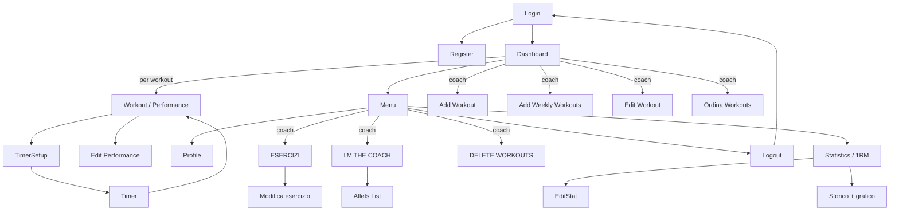

# 10 – UI, navigazione, testi e PWA

> **Stato**: la sezione seguente fissa la direzione per la nuova app; il resto del documento
> descrive il legacy.

## Direzione per la nuova app

### Identità visiva

RF-10-D1 – Il **logo LIFTOFF non si tocca**: stesso file vettoriale, stesse proporzioni,
usato su fondo nero (versione bianca) e, dove serve, su fondo bianco (versione nera). Nessuna
variante colorata.

RF-10-D2 – L'app è **bianca e nera**, coerente con il logo. Palette:

| Token | Valore | Uso |
|-------|--------|-----|
| `ink` | `#000000` | sfondo principale in tema scuro, testo in tema chiaro |
| `paper` | `#FFFFFF` | testo in tema scuro, sfondo in tema chiaro |
| `surface-1` | `#111111` / `#F5F5F5` | card, pannelli |
| `surface-2` | `#1C1C1C` / `#EBEBEB` | elementi sovrapposti, input |
| `line` | `#2E2E2E` / `#D9D9D9` | bordi e divisori |
| `muted` | `#9A9A9A` / `#6B6B6B` | testo secondario |
| `danger` | `#A50404` | solo azioni distruttive, come oggi |

Non esiste un colore d'accento: l'azione primaria è un pulsante **pieno bianco con testo
nero** (o l'inverso in tema chiaro). La gerarchia si ottiene con contrasto, peso del carattere
e dimensione, non con il colore.

RF-10-D3 – Unica eccezione al bianco e nero: le **zone cardiache** (Z1 grigio, Z2 blu, Z3
verde, Z4 arancio, Z5 rosso) e i grafici dove servono più serie. Anche lì, un solo colore
per volta sullo schermo dove possibile.

RF-10-D4 – Tema scuro predefinito, tema chiaro disponibile dalle impostazioni (stessa
palette invertita). Il timer è sempre su fondo nero.

RF-10-D5 – Tipografia: un solo carattere sans-serif con pesi variabili (es. Inter o
Manrope), numeri tabulari per score, carichi e timer; titoli in maiuscolo con leggera
spaziatura per richiamare il lettering del logo. Timer con carattere monospace grande.

RF-10-D6 – Componenti: pulsante primario pieno, secondario outline bianco 1px, terziario
solo testo; card con bordo 1px senza ombre; angoli 8px; icone a linea (Material Symbols
outlined). Nessun gradiente, nessuna ombra.

### Navigazione

RF-10-D7 – Bottom navigation a 4 voci per l'atleta: **Oggi**, **Progressi**, **Massimali**,
**Profilo**. Per coach e superuser una quinta voce **Coach** (programmazione, atleti,
catalogo, messaggi, log; per il superuser anche account e impostazioni).

RF-10-D8 – La sezione **Messaggi** è raggiungibile dall'icona con badge in alto a destra nella
schermata Oggi.

RF-10-D9 – Orientamento verticale bloccato su telefono; su tablet e web layout adattivo con
rail laterale.

### Testi e frasi

RF-10-D10 – Testi di sistema in italiano, neutri, orientati all'azione (RF-01 "Lingua e
tono"). Le etichette legacy in inglese (Add Workout, Statistics, I'M THE COACH…) vengono
sostituite.

RF-10-D11 – **Le frasi motivazionali e da rest day restano**, sono parte dell'identità del
progetto. Vengono migrate come contenuto iniziale di una lista **modificabile dal coach**
dalle impostazioni (aggiunta, modifica, disattivazione singola, ripristino delle originali).
Compaiono a fondo pagina nella schermata Oggi e nella schermata di fine timer. Il coach può
disattivarle del tutto.

RF-10-D12 – Le frasi contenenti insulti diretti all'utente o volgarità pesanti vengono
riviste in fase di migrazione mantenendo il tono; lo slang e le frasi storiche del box
("SÌ VOLA", "PAZZESCO !", "REST IND' O' LIET"…) restano intatte.

RF-10-D13 – Stati vuoti e attesa attivazione hanno testi di sistema (neutri) con azione
utile; la frase di personalità può comparire sotto, separata visivamente.

### Testi di sistema di riferimento

| Contesto | Testo |
|----------|-------|
| Atleta non abilitato | "Account in attesa di attivazione. Il tuo coach ti abiliterà a breve." |
| Massimale mancante | "Massimale di {esercizio} non registrato. Inseriscilo per vedere i carichi calcolati." |
| Percentuali | "Sul tuo {tipo test} di {esercizio}: {valore} {unità}" |
| Nessuno score | "Nessuno score registrato. Sii il primo." |
| Nessun massimale | "Nessun massimale registrato." |
| Nessun workout | "Nessun allenamento programmato per oggi." + frase rest day sotto |
| Fine timer | "Finito." + score precompilato + frase motivazionale sotto |
| Nuovo PR | "Nuovo record personale: {esercizio} {valore}." |
| Errore di rete | "Connessione assente. I dati verranno sincronizzati appena possibile." |

---

# Comportamento legacy (riferimento)

## Identità visiva

RF-10-01 – Tema **dark monocromatico**: sfondo nero `#000`, testo bianco `#fff`, bordi bianchi 1px, angoli arrotondati (4–12px). Nessun colore d'accento tranne rosso `#a50404` per le azioni distruttive e `cadetblue` per il pulsante modifica workout. Font body Arial/sans-serif; titoli Raleway 700 maiuscolo con letter-spacing. Timer con font monospace (Courier New) molto grande.

RF-10-02 – Logo `logo.svg` (LIFTOFF) nell'header di login e dashboard (esiste anche `logo_christmas.svg` per il periodo natalizio, non collegato). Icone Bootstrap Icons.

RF-10-03 – Layout mobile-first, contenitore max 900px, **barra inferiore fissa** con un pulsante di navigazione principale (Menu / Dashboard / Back / Indietro) su tutte le pagine.

RF-10-04 – Messaggi flash (successo/errore/info) mostrati in alto e nascosti automaticamente dopo 3 secondi.

RF-10-05 – Pulsanti: stile "outline" bianco su nero che si inverte al tocco; pulsanti azione quadrati 46×36 con sola icona; conferme distruttive tramite `confirm()` nativo dove presenti.

## Mappa di navigazione

RF-10-06 – Menu (`/menu`): pulsanti verticali PROFILE, STATISTICS, LOGOUT; per il coach in testa I'M THE COACH, ESERCIZI, DELETE WORKOUTS. Bottom bar "Dashboard".

## PWA / installazione

RF-10-07 – Manifest: nome `LIFTOFF`, descrizione "LIFTOFF - JUST TRAINING", `display: standalone`, `orientation: portrait-primary`, background nero, theme color bianco, icone 192 e 512 (Android) + apple-touch-icon 512. Meta `apple-mobile-web-app-capable`.

RF-10-08 – Banner di installazione sulla pagina login (si nasconde dopo 10 s):
- iOS non in standalone: "Per installare LIFT OFF sul tuo iPhone: apri il menu Condividi e seleziona "Aggiungi a Home"."
- Android/desktop con `beforeinstallprompt`: "Installa LIFT OFF come app sul tuo dispositivo." + pulsante "Installa".

Per Flutter: l'app nativa sostituisce la PWA; mantenere nome, icona e orientamento portrait bloccato (il timer è pensato in verticale).

## Testi ricorrenti

| Contesto | Testo |
|----------|-------|
| Atleta non abilitato | "Atleta non abilitato" / "Attendi che il supremo coach ti ritenga degno" |
| Massimale mancante | "Massimale di {esercizio} non trovato, quando cazzo ti decidi a registrarlo? Inserisci 1RM" |
| Percentuali | "In base al tuo RM di {esercizio} a {valore} Kg" (kg) / "… di {valore} {unità}" (altre) |
| Nessuno score | "You are the first performer!" |
| Nessun massimale | "Nessuna statistica inserita" |
| Stats hint | "Seleziona la checkbox per eliminare. Tocca il nome dell'esercizio per modificare." |
| Storico | "Progressione 1RM" / "Segui il miglioramento dei massimali nel tempo." |
| Timer | "Preparati", "GO!", "Tocca lo schermo per +1 round", "Terminare il workout? Il tempo verrà fermato.", "FINITO!", "TERMINATO", "SALVA SCORE", "TORNA AL WORKOUT" |
| Registrazione | "Registrati", "Già registrato? Effettua il login!", "Registrazione Coach" |

## Frasi motivazionali (footer dashboard con workout)

Selezione: 50% da `common_phrases`, 50% da `other_phrases`, casuale.

`common_phrases`:
RINAL METTI LO SCORE! · SÌ VOLA · LE COSE VANNO BENE · FAJ PAUR 🤌🏽 · PAZZESCO ! · TUTTO NELLA SERENITÀ · SIUUP · STA SUCCENNDO · NELLA SIUP LIFE · JUST WORK NOT PLAY

`other_phrases`:
NON SENTO NIENTE · RESPIRA DOPO · MUOVITI · NON MOLLARE · SOFFRI MEGLIO · ANCORA UNO · ZITTO E SPINGI · STRINGI I DENTI · NON FARE IL DEBOLE · QUI SI SPINGE · DAI. ORA · NON SEI FINITO · PESO SERIO · LAVORA · SPACCA · FORZA BRUTA · ZERO SCUSE · OGGI SI SOFFRE. PUNTO · SE SEI STANCO, FUNZIONA · NON È IL MOMENTO DI PENSARE · IL CORPO MENTE · SPINGI ANCHE SE FA SCHIFO · NON SEI SPECIALE · FINISCI O COLLASSA · NESSUNO TI SALVA · IL WOD TI ODIA · SE RESPIRI, LAVORI · NON RALLENTARE · SPINGI E BASTA · OGGI SI ROMPE QUALCOSA · FINO IN FONDO · IL DOLORE È TEMPORANEO · IL DOLORE PASSA, LA GLORIA RESTA · NON È FINITA FINCHÉ NON SMETTI · IL LIMITE È NELLA TUA TESTA · NON C'È CRESCITA SENZA DOLORE · OGGI SI ENTRA INTERI, SI ESCE ROTTI · SE NON FA PAURA, NON È ABBASTANZA PESANTE · QUI NON SI VIENE PER STARE BENE · IL RISCALDAMENTO È GIÀ UNA MINACCIA · SE STAI COMODO, STAI SBAGLIANDO · IL CORPO VUOLE FERMARSI. FOTTITENE · LA GHISA NON HA PIETÀ. TU NEMMENO · OGNI WOD È UNA SCELTA DI VITA SBAGLIATA · QUI SI SOFFRE TUTTI UGUALI · SE NON SPUTI UN POLMONE, NON È FINITO · OGGI SI PAGA IL CONTO DEI GIORNI FACILI · IL DOLORE È IL COACH PIÙ ONESTO · NON CERCARE SCUSE, CERCA OSSIGENO · QUI SI CRESCE A FORZA · SE TREMI STAI FUNZIONANDO · LA FATICA NON UCCIDE. IL DIVANO SÌ · OGNI REP È UNA TRATTATIVA COL DIAVOLO · NON È STANCHEZZA, È DEBOLEZZA CHE ESCE · IL TIMER È IL TUO NEMICO · CHI PARLA TROPPO NON SPINGE ABBASTANZA · QUI NON SI ALLENA L'AUTOSTIMA · SE SORRIDI, MANCA PESO · IL CORPO URLA. LA TESTA DECIDE · ANCORA UNO ANCHE SE NON VUOI · IL WOD NON SI DISCUTE, SI SUBISCE · QUI NON C'È CONTROLLO: C'È ADATTAMENTO · IL BOX TI PRENDE A SCHIAFFI E TI MIGLIORA · SE SEI VIVO, PUOI FARE UN ALTRO REP · ALLENARSI STANCHI È IL PUNTO · QUI NON VINCI, SOPRAVVIVI · IL FIATO CORTO È TEMPORANEO · LA FORZA ARRIVA QUANDO SMETTI DI CHIEDERE PIETÀ · OGNI ALLENAMENTO È UNA GUERRA CIVILE · SE PENSI DI AVER FINITO, SEI ALL'INIZIO · IL FERRO PESA UGUALE PER TUTTI · OGGI NON SI MIGLIORA L'UMORE: SI MIGLIORA IL FISICO · CHI ENTRA CONVINTO ESCE UMILE · IL BOX NON CONSOLA, TRASFORMA · QUI SI SOFFRE PER SCELTA · IL DOLORE È IL PREZZO D'INGRESSO · IL WOD TI ODIA. RICAMBIA · RESPIRA QUANDO PUOI. SPINGI QUANDO DEVI · OGNI STOP È UNA SCONFITTA PERSONALE · QUI NON ESISTE ABBASTANZA FORTE · IL CORPO MOLLA DOPO LA TESTA. SEMPRE · SE NON TI MANCA L'ARIA, MANCA IMPEGNO · LA GHISA NON FA SCONTI · QUI SI DIVENTA DURI O SI SPARISCE · FINISCI. POI COLLASSA

## Frasi rest day (footer dashboard senza workout)

(Nota: il codice attuale non estrae mai la prima frase, indice random da 1.)

REST IND' O' LIET · OGGI WORKOUT? NO. REST · REST DAY: NON FACCIO UN CAZZO PER DIVENTARE PIÙ GROSSO · ALLENAMENTO DI OGGI: DORMIRE COME UN ANIMALE E MANGIARE COME UNA MERDA · OGGI NIENTE PALESTRA, I MUSCOLI STANNO URLANDO BASTA · WORKOUT SALTATO: RECUPERO IGNORANTE, ZERO SENSI DI COLPA · OGGI NON SPINGO PESI, SPINGO IL RECUPERO COME SI DEVE · REST DAY: SE MI ALLENO OGGI, DOMANI FACCIO CAGARE · ALLENAMENTO ANNULLATO: I MUSCOLI HANNO DETTO BASTA · OGGI ZERO WORKOUT. CRESCITA PASSIVA ATTIVATA · RIPOSO STRATEGICO: ALLENARSI STANCHI È DA COGLIONI · WORKOUT OFF. MANGIA, DORMI, STAI ZITTO · OGGI NON SI FA UN CAZZO. DOMANI SI SPACCA TUTTO · REST DAY VIOLENTO: RECUPERO PRIMA DI FARE DANNI SERI · PESI FERMI. BESTIA IN RICARICA · ALLENAMENTO MENTALE: CONVINCERMI CHE RIPOSARE NON È DA DEBOLI · OGGI IL WORKOUT MI GUARDA. IO LO IGNORO · REST DAY: CRESCO ANCHE SENZA FARE UN CAZZO. MIRACOLO · ALLENAMENTO FANTASMA. RECUPERO REALE · OGGI RIPOSO PERCHÉ SONO GROSSO, NON SCEMO · OGGI RIPOSO HARDCORE: DIVANO, CIBO E ZERO RIMORSI · WORKOUT SPENTO. CERVELLO SPENTO. RECUPERO ACCESO · OGGI NON SI VA IN PALESTRA PERCHÉ SIAMO STANCHI SUL SERIO · REST DAY IGNORANTE: I MUSCOLI RINGRAZIANO, IO PURE · ALLENAMENTO RIMANDATO: OGGI VINCONO SONNO E FAME · OGGI NIENTE GHISA, SOLO RECUPERO SELVAGGIO · RIPOSO TOTALE: MODALITÀ BESTIA OFF, MODALITÀ UMANO ON · WORKOUT CANCELLATO PER CAUSE DI FORZA MAGGIORE: IO · OGGI RECUPERO COME SE DOMANI DOVESSI SPACCARE TUTTO · REST DAY SACRO: CHI ALLENA SEMPRE È UN PAZZO
